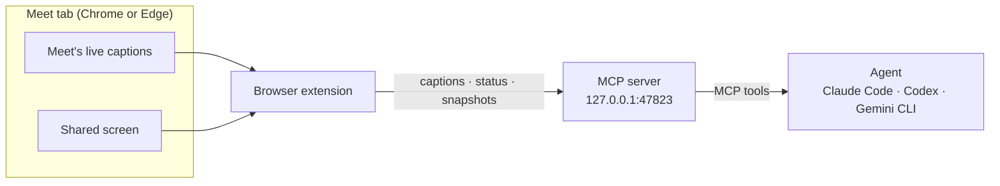

# Contributing to Sotto

## How it fits together



- **Browser extension** (`chrome-extension/`) reads Meet's caption list once a second and who is presenting, and posts them to the local server. It compares a 32×18 thumbnail of the largest video every two seconds and encodes a full snapshot only when someone else is presenting and the screen has changed and settled.
- **MCP server** (`mcp-server/server.py`) is standard-library Python. It speaks MCP over stdio to the agent and runs a loopback HTTP endpoint for the extension. The endpoint opens only after the agent calls `start`; a second session calling `start` takes the meeting over, transcript included. Requests must carry the `X-Sotto` header and no web-page origin.
- **Skill** (`skills/sotto/SKILL.md`) is the instructions every agent follows: the listening loop, when a cue is worth writing, and how to keep it short.

## Repository layout

```
chrome-extension/      browser extension (Manifest V3)
mcp-server/server.py   MCP server and loopback endpoint
skills/sotto/          the skill every agent follows
tests/                 server end-to-end tests and extension logic tests
.github/workflows/     release build

.claude-plugin/        Claude Code plugin, plus the marketplace Claude Code and Codex install from
.codex-plugin/         Codex plugin
gemini-extension.json  Gemini CLI extension
commands/sotto.toml    the /sotto command for Gemini CLI
```

The agent packaging sits at the top level because each agent requires it there. Gemini CLI reads its manifest, `skills/` and `commands/` only from the folder it installs, and Claude Code and Codex refuse server paths outside the plugin folder.

## Tools

| Tool | Purpose |
|---|---|
| `start` | Opens the local endpoint and reports what's connected: the Meet tab, captions on or off, who is presenting. Safe to call again as a status check. |
| `wait_for_update` | The listening loop. Waits up to 55 seconds for new speech, a screen change or a status change, then returns it. |
| `get_screen` | Returns a saved snapshot, or asks the tab for a fresh one. |
| `get_transcript` | Everything said so far, or the last N minutes. |
| `stop` | Stops listening and returns where the transcript and snapshots were saved. |

The three reading tools are annotated read-only, and the Codex plugin pre-approves all five, so the loop runs without prompts.

## Settings

| Variable | Default | Meaning |
|---|---|---|
| `SOTTO_PORT` | `47823` | Local port. Change it in `chrome-extension/manifest.json` and `chrome-extension/background.js` too. |
| `SOTTO_DIR` | `~/Sotto` | Where meetings are saved. |

## Working on it

Clone the repository, then point your browser and agent at the clone instead of the released copies:

| | Use your clone |
|---|---|
| Browser | **Load unpacked** on `chrome-extension/` |
| Claude Code | `claude plugin marketplace add ./sotto` then `claude plugin install sotto@sotto` (read in place) |
| Gemini CLI | `gemini extensions link ./sotto` (read in place) |
| Codex CLI | `codex plugin marketplace add ./sotto` then `codex plugin add sotto@sotto` (copied, so reinstall after changes) |

After changing the extension, reload it in `chrome://extensions` and refresh the Meet tab. After changing the server or the skill, start a new agent session.

## Tests

```bash
python -m unittest discover -s tests     # server, driven over MCP stdio and HTTP
node --test tests/content.test.mjs       # extension caption handling
claude plugin validate .                 # Claude Code plugin
gemini extensions validate .             # Gemini CLI extension
```

## Releasing

1. Set the new version in all four manifests: `chrome-extension/manifest.json`, `.claude-plugin/plugin.json`, `.codex-plugin/plugin.json` and `gemini-extension.json`.
2. Commit, then tag and push: `git tag v0.2.0 && git push origin main v0.2.0`.

The release workflow checks that every manifest carries the tag's version, runs the tests, zips `chrome-extension/` as `sotto-chrome-extension.zip`, and publishes a GitHub release with it. The README's download link always points at the newest release's zip.
