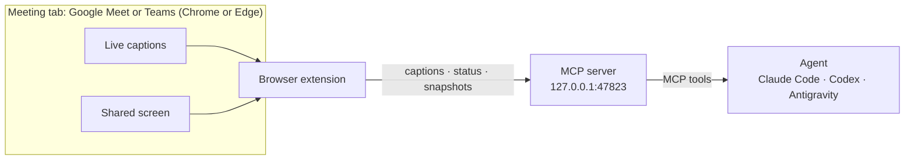

# Contributing to Sotto

## How it fits together



- **Browser extension** (`chrome-extension/`) reads the meeting's caption list once a second and who is presenting, and posts them to the local server. A small adapter per platform (Google Meet, Teams) knows where each page keeps its captions, call controls and shared screen; Teams keeps only the newest captions on the page, so when the visible window shifts the extension starts a new key epoch and the server matches re-sent rows to turns it already has. It compares a 32×18 thumbnail of the largest video every two seconds. It sends a snapshot on its own when someone else is presenting and the screen has changed and settled, and on request whenever the agent calls `get_screen`, which also covers your own presentation.
- **MCP server** (`mcp-server/server.py`) is standard-library Python. It speaks MCP over stdio to the agent and runs a loopback HTTP endpoint for the extension. The endpoint opens only after the agent calls `start`; a second session calling `start` takes the meeting over, transcript included. Requests must carry the `X-Sotto` header and no web-page origin.
- **Skill** (`skills/sotto/SKILL.md`) is the instructions every agent follows: the listening loop, when a cue is worth writing, and how to keep it short.

## Repository layout

```
chrome-extension/      browser extension (Manifest V3)
mcp-server/server.py   MCP server and loopback endpoint
skills/sotto/          the skill every agent follows
assets/                icon, and the README demo (assets/demo/)
tests/                 server end-to-end tests and extension logic tests
.github/workflows/     release build

.claude-plugin/        Claude Code plugin, plus the marketplace Claude Code and Codex install from
.codex-plugin/         Codex plugin
.antigravity-plugin/   Antigravity plugin
mcp_config.json        Antigravity plugin's server
```

The agent packaging sits at the top level because each agent requires it there. Antigravity reads `mcp_config.json` and `skills/` from the top of the plugin folder, and Claude Code and Codex refuse server paths outside the plugin folder. Antigravity starts the server from the plugin folder, so `mcp_config.json` refers to `./mcp-server`.

## Tools

| Tool | Purpose |
|---|---|
| `start` | Opens the local endpoint and reports what's connected: the meeting tab, captions on or off, who is presenting. Safe to call again as a status check. |
| `wait_for_update` | The listening loop. Waits up to 55 seconds for new speech, a screen change or a status change, then returns it. |
| `get_screen` | Returns a saved snapshot, or asks the tab for a fresh one. |
| `get_transcript` | Everything said so far, or the last N minutes. |
| `stop` | Stops listening and returns where the transcript and snapshots were saved. |

The three reading tools are annotated read-only, and the Codex plugin pre-approves all five, so the loop runs without prompts.

## Settings

| Variable | Default | Meaning |
|---|---|---|
| `SOTTO_PORT` | `47823` | Local port. Change it in `chrome-extension/manifest.json` and `chrome-extension/background.js` too. |
| `SOTTO_DIR` | `~/Sotto` | Where meetings are saved. |
| `SOTTO_UPDATE_CHECK` | `1` | `0` turns off the daily check for a newer release. |
| `SOTTO_UPDATE_URL` | GitHub's latest-release API | Where the check looks; the tests point it at a local stand-in. |

On `start`, the server asks `SOTTO_UPDATE_URL` for the latest release at most once a day, caching the answer in `SOTTO_DIR/update-check.json`. The extension reports its own version with every check-in. When either the plugin or the extension is older than the latest release, the agent hears it once, in `start`'s status or as a `[status]` line.

## Working on it

Clone the repository, then point your browser and agent at the clone instead of the released copies:

| | Use your clone |
|---|---|
| Browser | **Load unpacked** on `chrome-extension/` |
| Claude Code | `claude plugin marketplace add ./sotto` then `claude plugin install sotto@sotto` (read in place) |
| Antigravity | Copy the clone into `~/.gemini/config/plugins/sotto` (app or IDE), or `agy plugin install ./sotto` (CLI) |
| Codex CLI | `codex plugin marketplace add ./sotto` then `codex plugin add sotto@sotto` (copied, so reinstall after changes) |

After changing the extension, reload it in `chrome://extensions` and refresh the meeting tab. After changing the server or the skill, start a new agent session.

## Tests

```bash
python -m unittest discover -s tests     # server, driven over MCP stdio and HTTP
node --test tests/content.test.mjs       # extension caption handling
claude plugin validate .                 # Claude Code plugin
```

## Demo

`assets/demo.gif` is rendered from `assets/demo/demo.html`, a scene whose `render(t)` sets everything on screen for time `t`. `assets/demo/render.py` steps that clock in Chrome and encodes the frames with ffmpeg:

```bash
uv run --with playwright python assets/demo/render.py
```

It needs Google Chrome and ffmpeg. To change the story, edit the `speech` and `feed` timelines at the bottom of `demo.html`.

## Releasing

1. Set the new version in `chrome-extension/manifest.json`, `.claude-plugin/plugin.json`, `.codex-plugin/plugin.json`, `.antigravity-plugin/plugin.json` and `VERSION` in `mcp-server/server.py`.
2. Commit, then tag and push: `git tag v0.2.0 && git push origin main v0.2.0`.

The release workflow checks that all five carry the tag's version and runs the tests. It then builds `sotto-chrome-extension.zip` (the browser extension) and `sotto-antigravity-plugin.zip` (the plugin in a `sotto/` folder, for unzipping into Antigravity's plugins folder) and publishes both in a GitHub release. The README links to `releases/latest/download/<file>`, which always serves the newest release.
