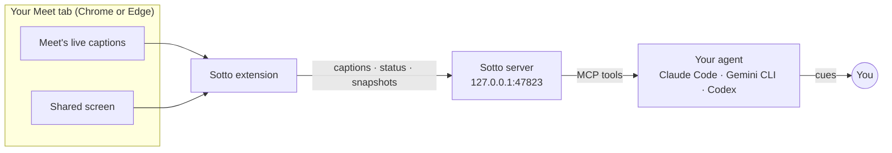

# Sotto

> *sotto voce* — in a quiet voice, so only the person beside you hears.

**A silent copilot for Google Meet, inside your AI agent: Claude Code, Gemini CLI or Codex.**


Sotto reads your own Meet tab (the live captions and whatever is being presented) and passes it to your agent. While the meeting is still going, the agent sends you short private cues: the question worth asking now, the objection that's coming, the number from your own work that settles the point.

Nothing joins the call, and nothing is said or posted into it. The only cost is your agent's subscription.

---

## What you see

The cues appear in your agent's chat while people talk:

```
— Rahul: "we can go live on the 15th, assuming your side has the webhook ready"

  Ask:   Which webhook — booking-created only, or reschedules and cancels too?
  Flag:  "Assuming your side" puts the date's risk on you. Get his dependency list in writing.

— Priya starts presenting the pricing deck

  Context: The slide says 38 paise/min; last week's quote in your notes was 34.

— You type: "what did we agree on SLAs last time?"

  Answer: 99.5% monthly uptime, with credits starting below 99%. It's in the vendor-eval doc.
```

Sotto stays quiet unless a cue would change what you say or do in the next minute. It doesn't narrate the meeting back to you.

## Why Sotto

- **It knows your work.** It runs inside the agent you already use, so mid-meeting it can look through your repositories, documents and notes. Typical meeting assistants only know the meeting.
- **Nothing joins the call.** There's no bot participant and nothing in the chat. It reads your own tab, the way you do.
- **It sees the screen.** When someone presents, Sotto snapshots the shared screen each time it changes, so your agent can read the slide, the dashboard or the doc.
- **Free.** It uses Meet's own captions: no transcription service, no API keys, no accounts.
- **Light.** The extension reads caption text once a second and compares a 32×18 thumbnail of the screen every two seconds. The server is a single standard-library Python file that idles at about zero CPU.
- **Any caption language.** Sotto works in every language Google Meet can caption. See [Languages](#languages).

## Works with

| Agent | How Sotto installs | Start it with | Status |
|---|---|---|---|
| **Claude Code** | Plugin (`.claude-plugin/`) | `/sotto` | Used in live meetings |
| **Codex CLI** | Plugin (`.codex-plugin/`) | `$sotto` | Installs and runs Sotto's tools end to end; not yet used in a live meeting |
| **Gemini CLI** | Extension (`gemini-extension.json`) | `/sotto` | Installs, connects and finds the skill; not yet used in a live meeting |
| **Any other MCP agent** | MCP server + `skills/sotto/SKILL.md` | depends on the agent | — |

Every agent uses the same server, extension and skill. Only the packaging differs.

## How it works



| Piece | What it does |
|---|---|
| **Extension** (`extension/`) | Reads Meet's caption list and who is presenting, then posts them to the local server. Encodes a full screen snapshot only when someone else is presenting and the screen has changed and settled. |
| **Server** (`server/server.py`) | An MCP server for your agent and a loopback endpoint for the extension, in one process with no dependencies. It opens its port only while you're listening. If another session starts listening, that session takes the meeting over, transcript included. |
| **Skill** (`skills/sotto/SKILL.md`) | Tells the agent how to run the meeting loop, when a cue is worth writing, and how to keep cues short. |

Each speaker turn reaches the agent once the speaker pauses, usually within a couple of seconds. During long monologues, updates come as the speaker goes.

## Setup

**You need:** Google Chrome or Microsoft Edge, one of the agents above, and [uv](https://docs.astral.sh/uv/). uv finds or fetches Python 3.9 or newer; no packages are installed. Meet's interface must be in English, because the extension finds the captions by their labels.

### 1. Get the code

```bash
git clone <repo-url> sotto
```

### 2. Load the browser extension

In the browser profile you join meetings from, open `chrome://extensions`, switch on **Developer mode**, click **Load unpacked**, and choose `sotto/extension`.

### 3. Add Sotto to your agent

<details open>
<summary><b>Claude Code</b></summary>

```bash
claude plugin marketplace add ./sotto
claude plugin install sotto@sotto
```

Then open a new Claude Code session; the server loads when a session starts.
</details>

<details>
<summary><b>Gemini CLI</b></summary>

```bash
gemini extensions link ./sotto
```

`link` uses your clone in place, so a `git pull` updates it. Restart Gemini CLI afterwards. When Gemini first asks to run a Sotto tool, choose to always allow it, so the listening loop isn't interrupted.
</details>

<details>
<summary><b>Codex CLI</b></summary>

```bash
codex plugin marketplace add ./sotto
codex plugin add sotto@sotto
```

Start a new Codex session afterwards. Sotto's tools are pre-approved in its plugin config, so the listening loop runs without prompts. Codex installs a copy of the plugin, so after a `git pull`, reinstall with `codex plugin remove sotto@sotto` and `codex plugin add sotto@sotto`.
</details>

<details>
<summary><b>Any other MCP agent</b></summary>

Register a stdio MCP server that runs `uv run --quiet --no-project server.py` with `sotto/server` as its working directory. Then give the agent the instructions in `skills/sotto/SKILL.md`, as a skill if it supports them or as a custom prompt if not.
</details>

## Using Sotto

1. **Join the meeting** in Chrome and turn captions on (press `c`). Only you see them.
2. **Start Sotto** in your agent and tell it what the meeting is for:

   ```
   /sotto Vendor call on telephony pricing. I want under 40 paise a minute and a 30-day pilot.
   ```

   In Codex, type `$sotto` instead of `/sotto`.

   The brief is optional. On its own, `/sotto` works out the context from the conversation. A good brief says what you want out of the meeting, who's on the other side, and anything to watch for.

3. **Talk to it any time.** Type into the same session: "what should I ask about SLAs?", "is that number right?", "summarise the last five minutes". It answers, then goes back to listening.
4. **Finish.** Say "stop", or just leave the call. Sotto writes a wrap-up: decisions, action items with owners, and open questions.

**Tips**

- Keep the agent on a second screen, next to the meeting.
- When you present, share a tab or a window rather than your whole screen.
- A faster model makes cues arrive sooner.

## Languages

Sotto works in any language Google Meet can caption ([see Google's list](https://support.google.com/meet/answer/15077804)). Meet captions one language at a time, so set it to the language the meeting is in:

1. In the meeting, open **⋮ More options → Settings → Captions**.
2. Under **Language of the meeting**, choose the language.

The agent writes its cues in the language you write to it in, whatever the caption language is.

## Privacy

- **On your computer:** the transcript and screen snapshots, saved to `~/Sotto/meetings/<date>_<meeting-code>/`. Delete them whenever you like.
- **Sent to your agent's model provider:** the caption text, and any snapshots the agent looks at, go to the company behind your agent (Anthropic, Google or OpenAI) as part of your session, under your existing terms with them.
- **Sent anywhere else:** nothing. There's no other service and no telemetry, and nothing is posted to the meeting.
- **Other participants:** they aren't notified. Whether and how to tell them is up to you. Follow your organisation's rules, especially for calls with customers.

The local endpoint only answers requests carrying Sotto's own header, and refuses anything sent by a web page, so other sites you have open can't push data into it.

## Tools

Sotto gives your agent five MCP tools:

| Tool | Purpose |
|---|---|
| `start` | Opens the local endpoint and reports what's connected: the Meet tab, captions on or off, who is presenting. Safe to call again as a status check. |
| `wait_for_update` | The listening loop. Waits up to 55 seconds for new speech, a screen change, or a status change, then returns it. |
| `get_screen` | Returns a saved snapshot, or asks the tab for a fresh one. |
| `get_transcript` | Everything said so far, or the last N minutes. |
| `stop` | Stops listening and returns where the transcript and snapshots were saved. |

## Configuration

| Variable | Default | Meaning |
|---|---|---|
| `SOTTO_PORT` | `47823` | Local port. If you change it, change it in `extension/manifest.json` and `extension/background.js` too. |
| `SOTTO_DIR` | `~/Sotto` | Where meetings are saved. |

## Limits

- **Caption accuracy.** Names, numbers, and speech in a language other than the caption language come through garbled. The agent reads past a lot of it from context, but it can't hear the audio.
- **Screen snapshots** come from the biggest video in the tab while someone else presents. Your own shared screen isn't captured. Seeing snapshots needs an agent that shows images returned by MCP tools.
- **Google Meet only,** in Chrome or Edge, with Meet's interface in English.

## Development

```
.claude-plugin/        Claude Code plugin manifest and local marketplace
.codex-plugin/         Codex plugin manifest
.agents/plugins/       Codex marketplace
gemini-extension.json  Gemini CLI extension manifest
commands/sotto.toml    the /sotto command for Gemini CLI
extension/             Chrome extension (Manifest V3)
server/server.py       MCP server and loopback endpoint, standard library only
skills/sotto/          the skill every agent follows
tests/                 server end-to-end tests and extension logic tests
```

```bash
python -m unittest discover -s tests     # server, driven over MCP stdio and HTTP
node --test tests/content.test.mjs       # extension caption handling
claude plugin validate .                 # Claude Code plugin manifest
gemini extensions validate .             # Gemini CLI extension manifest
```

After editing the extension, reload it in `chrome://extensions` and refresh the Meet tab. After editing the server or the skill, start a new agent session.
