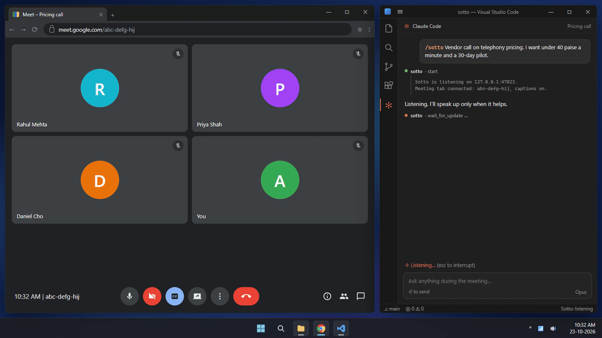

<p align="center"></p>

# Sotto

> *sotto voce* — in a quiet voice, so only the person beside you hears.

**A silent copilot for your Google Meet and Microsoft Teams calls, inside the AI agent you already use.**


Sotto follows your meeting as it happens: what people say, and whatever they put on screen. While the conversation is still going, your agent sends you short private cues: the question worth asking now, the objection that's coming, the fact from your own work that settles the point.

---

## What you see



Sotto speaks up only when it has something useful, and stays quiet the rest of the time.

## Why Sotto

- **It knows your work.** Sotto runs inside your AI agent, so mid-meeting it can look through the projects, documents and notes your agent can see.
- **Nothing joins the call.** There's no bot in the participant list, and nothing is said or posted in the meeting.
- **It sees the screen.** When someone presents, your agent can read the slide, dashboard or document they're showing.
- **Free and light.** It uses the meeting's own captions, so there's no transcription service, no API key and no account to create. It barely uses your computer.
- **Any caption language.** It works in every language Google Meet or Teams can caption.

## What you need

- One of these AI agents: **Claude Code**, **Codex CLI** or **Antigravity**
- **Google Meet** or **Microsoft Teams**, joined in **Google Chrome** or **Microsoft Edge** (not the Teams app), with the meeting's interface in English

## Install

You only do this once.

### 1. Install uv

Sotto needs [uv](https://docs.astral.sh/uv/), a small free tool that runs its background helper. Skip this step if you already have it.

**Windows** (PowerShell):

```powershell
powershell -ExecutionPolicy ByPass -c "irm https://astral.sh/uv/install.ps1 | iex"
```

**macOS or Linux:**

```bash
curl -LsSf https://astral.sh/uv/install.sh | sh
```

### 2. Add the browser extension

1. **[Download the Sotto extension](https://github.com/amn-max/Sotto/releases/latest/download/sotto-chrome-extension.zip)**.
2. Unzip it into a folder you'll keep, such as `Documents\Sotto extension`. The browser loads Sotto from that folder, so don't delete it.
3. Open `chrome://extensions` (or `edge://extensions`), switch on **Developer mode**, click **Load unpacked**, and choose the folder you unzipped.

Do this in the browser profile you join meetings from.

### 3. Add Sotto to your agent

<details open>
<summary><b>Claude Code</b></summary>

In a terminal:

```bash
claude plugin marketplace add amn-max/Sotto
claude plugin install sotto@sotto
```

Or inside Claude Code: `/plugin marketplace add amn-max/Sotto`, then `/plugin install sotto@sotto`.
</details>

<details>
<summary><b>Codex CLI</b></summary>

```bash
codex plugin marketplace add amn-max/Sotto
codex plugin add sotto@sotto
```
</details>

<details>
<summary><b>Antigravity</b></summary>

**App or IDE:**

1. **[Download the Sotto plugin](https://github.com/amn-max/Sotto/releases/latest/download/sotto-antigravity-plugin.zip)**.
2. Unzip it into your Antigravity plugins folder: `~/.gemini/config/plugins` (on Windows, `%USERPROFILE%\.gemini\config\plugins`).
3. Restart Antigravity.

**CLI:**

```bash
agy plugin install https://github.com/amn-max/Sotto
```

The first time Antigravity asks to run a Sotto tool, choose to always allow it, so it can keep listening without stopping to ask.
</details>

Then start a new session in your agent.

## Use it

1. **Join your meeting** in the browser and turn on captions. In Google Meet, press `c` or click **CC**; in Teams, open **More** and turn on **Captions**. Only you see them.
2. **Start Sotto** with `/sotto` (`$sotto` in Codex; in the Antigravity IDE, ask the agent to start Sotto), and say what the meeting is about and what you want from it:

   ```
   /sotto Vendor call on telephony pricing. I want under 40 paise a minute and a 30-day pilot.
   ```

   The description is optional; with just `/sotto`, it works out the context as the meeting goes. The more you tell it (your goal, who's on the other side, what to watch for), the sharper the cues.

3. **Ask it anything along the way.** Type into the same chat: "what should I ask about SLAs?", "is that number right?", "summarise the last five minutes". It answers, then goes back to listening.
4. **Finish.** Say "stop", or just leave the call. Sotto writes a wrap-up of decisions, action items with owners, and open questions.

**Tips**

- Keep your agent on a second screen, or beside the meeting window.
- When you share your screen, share a tab or a window rather than the whole screen, so your cues stay private.
- A faster model makes cues arrive sooner.

## Languages

Sotto works in any language your meeting can caption. Captions follow one language at a time, so set them to the language the meeting is in:

- **Google Meet** ([supported languages](https://support.google.com/meet/answer/15077804)): open **⋮ More options → Settings → Captions**, and choose the language under **Language of the meeting**.
- **Teams:** open the captions settings and change the **spoken language**.

Your agent writes its cues in the language you write to it in, whatever language the captions are in.

## Updating

When a new version is out, Sotto tells you in your agent the next time you start it, with a link. To update:

- **Browser extension:** [download the zip](https://github.com/amn-max/Sotto/releases/latest/download/sotto-chrome-extension.zip) again, unzip it over your existing Sotto folder, then click the reload button on Sotto's card in `chrome://extensions`.
- **Claude Code:** `claude plugin marketplace update sotto`, then `claude plugin update sotto@sotto`. To have Claude Code update Sotto by itself, open `/plugin`, go to **Marketplaces**, choose **sotto** and turn on **Enable auto-update**.
- **Codex CLI:** `codex plugin marketplace upgrade`, then `codex plugin add sotto@sotto`.
- **Antigravity:** download and unzip the plugin again over the old one (or rerun `agy plugin install` in the CLI), then restart Antigravity.

## Troubleshooting

| What you see | What to do |
|---|---|
| "Meeting tab not connected" | Check that Sotto is switched on in `chrome://extensions`, then refresh the meeting tab. |
| "Captions are OFF" | In Google Meet, press `c` or click **CC**. In Teams, open **More** and turn on **Captions**. |
| Cues don't match what's being said | Check the caption language (see [Languages](#languages)). |
| `/sotto` isn't recognised | Start a new session in your agent after installing. |
| "Port 47823 is held by another program" | Another app is using the port Sotto needs. Close that app, then start Sotto again. |

## Privacy

- **Stays on your computer:** the meeting transcript and screen snapshots, saved in a `Sotto` folder in your home folder. Delete them whenever you like.
- **Goes to your agent's provider:** the caption text, and any snapshots your agent looks at, go to the company behind your agent (Anthropic, OpenAI or Google) as part of your normal session with them.
- **Version check:** once a day, when you start Sotto, it asks GitHub for the latest version number. Nothing about you or your meetings is sent. To turn it off, set the environment variable `SOTTO_UPDATE_CHECK=0`.
- **Goes nowhere else:** there's no Sotto server, no account and no tracking.
- **Other people in the meeting** aren't notified. Whether and how to tell them is up to you. Follow your organisation's rules, especially for calls with customers.

## Limits

- **Captions aren't perfect.** Names, numbers, and speech in a language other than the caption language can come through garbled. Your agent reads past a lot of it from context, but it can't hear the audio.

---

Building on Sotto or changing it? See [CONTRIBUTING.md](CONTRIBUTING.md).
